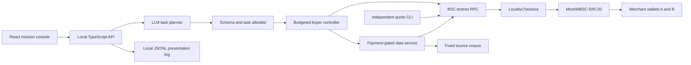

# Repeat — Agent Loyalty Protocol

Current correction: loyalty is per buyer + seller + service SKU. See [IMPLEMENTATION_STATUS.md](IMPLEMENTATION_STATUS.md) for verified behavior, SDK/on-chain boundaries and agent test evidence.

Prepared 16 October 2026 for one builder and a four-hour build sprint.

Updated product direction17October2026: wallet sign-in, user/agent service marketplace and portable agent access. See [MARKETPLACE.md](MARKETPLACE.md) for the current architecture and final ideal demo. The original loyalty demonstration below remains a focused Demo lab.

**Recommendation:** build a loyalty-aware AI buyer on BNB Smart Chain testnet. Prove that paid history changes its effective price and provider choice. Use service-specific, immediate discounts, a shared payment-derived ledger, and a small service that actually returns data.

**Deliverables in this pack**

- This file: idea validation, pitches, judge demo, architecture, component stacks, and acceptance criteria.
- [DEV_RESOURCES.md](DEV_RESOURCES.md): development links, installation recipes, environment configuration, verification commands, and a coding-agent brief.
- [FOUR_HOUR_BUILD_PLAN.md](FOUR_HOUR_BUILD_PLAN.md): timed implementation tasks with files, interfaces, tests, output checkboxes, and cutoffs.

This document records the design and build plan. A working local-EVM implementation now exists; see [README.md](README.md) and [BUILD_PROGRESS.md](BUILD_PROGRESS.md) for current setup, verified evidence and remaining live integrations.

## 1. Event context and assumptions

The [official event](https://luma.com/ldp3i5kn) is **BNB Builder Hack: Kuala Lumpur**, 17 October 2026, 8:30am–7:30pm MYT, at Taylor's University in Petaling Jaya. Its registration form offers Solo/Group participation. Plan to submit **before 5pm**; the page advertises top-eight demos and prizes of $250, $150, and $100. Registration currently shows full/waitlist. The live and cached agendas differ in later judging times, so recheck on arrival.

The event emphasizes BNB Agent Studio, agent commerce, and autonomous on-chain activity. The published page does **not** establish a judging rubric, submission format, prebuilt-code policy, or minimum required Studio integration.

Before the sprint, confirm with a mentor: whether a custom BSC contract plus autonomous agent qualifies, whether native Studio payment integration is required, and which setup/code may be prepared beforehand. Confirm the submission link and demo duration. These are organizer questions, not known rules.

**Build assumption:** the custom BSC checkout is eligible. If Studio integration is mandatory, use the separate Studio-native fallback in section 7; do not claim that our custom checkout is ERC-8183 or B402.

## 2. Validate the idea

### Verdict

**Good hackathon direction; unvalidated business; ordinary loyalty tiers are already competitive territory.**

The useful problem is that an agent making recurring purchases needs its actual eligible price, rather than only the public list price. A seller wants to reward repeat customers without rebuilding a loyalty database in every frontend. A shared ledger is useful when several applications need the same payment-derived eligibility.

For a single provider and one frontend, a normal database is usually simpler. Blockchain earns its place here only if the demo shows another client independently reading the same history and the contract enforcing the discounted payment.

### What already exists

- **PayPerAgent:** documents tiered agent discounts, success-rate conditions, and batch discounts in a SKALE testnet proof of concept. Tiered agent discounts are therefore not a novelty claim. [Project README](https://github.com/TheQuantumChronicle/payperagent)
- **402Gate:** documents agent rebates and usage cashback in its reward token. Our MVP avoids a separate reward token and gives a lower price immediately. Its documented rewards are not independently verified payouts. [Rewards](https://docs.402gate.com/ecosystem-and-rewards/user-and-ai-agent-rewards)
- **Agentic Commerce Protocol:** its checkout reference already represents loyalty and discount information. Machine-readable discounts alone are insufficient differentiation. [Checkout reference](https://www.agenticcommerce.dev/docs/reference/checkout)
- **Nevermined:** its dynamic-pricing guide already shows subscriber-specific usage tiers and quote estimation. The sample uses a seller's usage tracking system. A shared payment-derived history is the narrower experiment here. [Dynamic pricing](https://nevermined.ai/docs/integrate/patterns/dynamic-pricing)

These are documentation/source comparisons, not benchmarks of deployed competitors. We have not established that competitors lack portable history or that this exact combination is unique.

### Positioning to use

> A reusable loyalty layer that lets AI buyers discover and redeem service-specific discounts from verifiable paid history on BNB Chain.

The four-hour proof is **same buyer wallet, same merchant history, different clients, enforced effective price**. History is portable across participating interfaces; another merchant is not obliged to honor it. Wallet rotation, cross-chain portability, and broad marketplace adoption remain future work.

### Initial customer and value hypothesis

Start with API/data providers selling frequently consumed, equivalent services to agent developers. A merchant can embed one checkout integration; an agent can query its eligibility before spending. Test these hypotheses after the hack:

- Three provider interviews: would they fund a 10–20% repeat-customer discount, and for which service margins?
- Three buyer-developer interviews: does losing purchase history across interfaces happen often enough to matter?
- One external developer: can they build the second reader without access to our backend database?
- Measure repeat purchase rate, merchant margin after discount, integration time, and savings after gas. Do not infer these outcomes from a testnet demo.

Potential revenue is an integration/API subscription or marketplace licensing. A payment fee is a later experiment; the demo has no fee or token business model.

### Three implementation choices

1. **Recommended: atomic loyalty checkout on BSC testnet.** Two contracts, two demo sellers, one buyer, one UI. It provides real payment enforcement with the fewest external dependencies. Native Studio commerce is a later adapter.
2. **Studio-native ERC-8183 integration.** Strong event alignment and richer job completion semantics, but requires inspecting generated signing code, the deployed job ABI, and settlement timing. Treat it as a separate route if organizers require it, not an extra half-hour feature.
3. **Off-chain points dashboard.** Fastest prototype, but weak evidence for why blockchain or a protocol is needed. Keep it only as an openly labeled fallback if testnet infrastructure fails.

## 3. Pitch

### One sentence

**Repeat lets an AI buyer pay its earned customer price, with loyalty enforced by paid history on BNB Chain.**

### Thirty seconds

> AI agents can pay for APIs, but repeat customers should not have to start from zero whenever they change apps. Repeat records paid purchases on BNB Chain and lets each seller offer its own repeat-customer price. The buyer compares its eligible quotes and purchases within a fixed budget. Watch it earn a discount, use it, and switch away when a better offer appears. The same history is readable from another client, without a reward token.

### Ninety seconds

> AI agents are becoming repeat customers for data and services. The cheapest advertised price is not always their cheapest actual price, because loyalty and volume discounts depend on their history.
>
> Repeat demonstrates a shared loyalty layer on BNB Chain. A successful payment through our checkout updates the buyer's paid spend with that seller. The seller publishes a discount policy. The buyer reads its effective prices, buys an equivalent service within its owner's budget, and receives the data.
>
> Here, three purchases unlock Seller A's repeat-customer price. Seller B lowers its public price, but A is still cheaper for this buyer. A fresh wallet sees a different best offer. When B undercuts even A's earned price, the buyer switches. It never buys unnecessary requests to farm status.
>
> Agent discounts already exist. Our experiment is whether payment-derived eligibility shared across clients makes those benefits easier to verify and reuse. The prototype uses testnet payments and immediate discounts. Production work includes seller adoption, privacy, delivery and refund handling, and checking whether savings justify transaction costs.

### Judge questions

- **Why BNB?** The prototype enforces payment and shared eligibility on BSC testnet and fits agent commerce. Show chain ID, contract, and receipts. Do not claim a measured speed or fee advantage.
- **Where is the AI?** A real model maps the user's mission to allowed data requests. A deterministic controller compares quotes and executes bounded purchases. Show both the model's plan and the controller's decision inputs. The model never handles a key or transaction payload.
- **Why a chain?** Another client can recover the same paid history without our application database; the price is enforced at checkout. One operator alone would not justify a protocol.
- **Is this new?** Discounts and agent rewards exist. We are testing shared, payment-derived, service-specific eligibility plus autonomous redemption; we do not claim to be first.
- **Can agents farm it?** Paid-spend thresholds reduce cheap-call inflation, and there is no external cashback pool. Collusion and fake economic demand remain possible. This is purchase history, not reputation or proof of unique ownership.
- **Why discount?** A merchant chooses a retention policy and funds it through lower revenue on future sales. Retention and profitability are hypotheses.
- **Does payment prove delivery?** No. Core checkout proves payment and access entitlement. The UI separately reports whether the HTTP service returned a result. There is no delivery escrow in the core.
- **Does every seller honor the tier?** Each seller has its own policy and spend bucket. Portability is across clients reading the same state.

## 4. The final demo

### Demo product

One screen: **mission → competing quotes → decision → confirmed payment → returned data**.

Example live mission: “Get this BNB research record. Spend no more than 0.06 wBSC.” Map the request to `bnb-budget` in the supplied documentation corpus. Three earlier, separately requested records establish the returning buyer's history; the fourth record is bought live. The corpus contains four distinct, timestamped source records. Both providers implement the same response schema and serve equivalent data. Label it a **fixed demo corpus**, not live market intelligence.

The prior three purchases belong to a labeled setup run. Do not ask the live planner to buy those records again merely to reach a tier. Show **lifetime merchant spend** separately from **this mission's spend and remaining budget**: after the live fourth purchase these are 0.19, 0.04, and 0.02 wBSC respectively. A supported multi-task mission may request up to four unique records, but the judge preset requests only the remaining record. The configurable application ceiling remains 0.30 wBSC; the judge mission deliberately requests the smaller 0.06 cap.

Use two logical provider endpoints and separate merchant wallets. Both are operated by the builder in this prototype; independent commercial operators are future validation.

### Exact economics

- Token: **wBSC**, our six-decimal, mintable test token. It has no dollar backing or real monetary value. tBNB separately pays gas.
- Seller A: base price **0.050000 wBSC**, 20% discount once prior paid spend for that same A service is **at least 0.150000 wBSC**.
- Seller B initially: **0.055000 wBSC**, no discount.
- A service earns eligibility after three legitimate 0.05 purchases of that same service. Purchase three is full price; **purchase four** is 0.04.
- After warm-up, merchant B changes its on-chain offer to **0.045000**. Returning buyer: A=0.04 versus B=0.045, so buy A. Fresh-wallet preview: A=0.05 versus B=0.045, so B would win.
- Optional final action: B changes to **0.035000**. Show that B is now the best quote. An actual additional purchase requires a new explicitly requested mission with its own approved budget: the original mission has only0.02 remaining and cannot afford0.035. If no new task exists, show the new quote and stop.

Four A purchases cost **0.19 wBSC**, against **0.20** at A's undiscounted list price. Display **0.01 wBSC gross discount**, not “20% total savings.” The fourth purchase alone is 20% cheaper. Under the same time-varying offers, the no-loyalty cheapest-provider baseline costs 0.195, so the route-level advantage is only **0.005 wBSC**. Keep those baselines distinct.

With the optional fifth B purchase in a new mission, cumulative spend across setup and both live missions is0.225; the same selected sellers' list-price total is0.235; the no-loyalty cheapest-provider baseline is0.230. A new0.06 mission spending0.035 has0.025 remaining. These cumulative totals are separate from each mission's budget. All figures exclude gas. Show gas in tBNB; do not combine currencies without a timestamped exchange rate.

### Two-minute judge sequence

Use the five-step script in [Final ideal output](#9-final-ideal-output) as the presentation sequence. It starts with public offers, reveals the returning buyer's history, makes one discounted purchase live, and finishes with an independent client reading the same eligibility. Competitor repricing to0.035 is optional after that complete loop.

If a two-minute slot is strict, perform only purchase four live. Keep the competitor switch, fresh-wallet negative case, and replay rejection as short clips or Q&A actions. Do not wait on cloud deployment during a presentation.

**Preserve demo state:** prepare separate rehearsal and judge buyer wallets, each with three genuine warm-up purchases. Record the rehearsal's fourth purchase as the backup video; do not consume the judge wallet's fourth purchase before judging. Before the main take, restore B's `bnb-budget` offer to0.045 and confirm its version, select the reserved judge wallet, and read its A spend=0.15. Wallet switching is a local operator configuration; it never resets chain state.

### Screen priorities

- Large effective prices and the selected provider.
- Buyer identity/address, mission, remaining task count and remaining budget.
- Separate list price, current discount, paid total, gross discount and tBNB gas.
- A compact event feed: plan validated, quotes read, provider selected, transaction submitted, payment confirmed, result returned.
- One result panel with source URL and corpus timestamp.
- A technical drawer for chain ID, addresses, offer version and transaction links.

Use four controls at most: **Run mission**, **Preview fresh wallet**, **Change competitor offer**, **Stop**. Prevent concurrent runs. A new session changes the wallet or uses genuinely new order IDs; it does not pretend to reset immutable chain history.

### Evidence versus simulation

For the **target demo**, these must be real: contract reads, paid-spend state, quote arithmetic, transfers, one live discounted purchase, receipt parsing, a served result, independent CLI quote, and at least one live model-generated task plan. The smaller deterministic-planning fallback is an automation demo with a missing AI criterion; label it and do not describe it as the complete target.

Demo assumptions: fixed corpus, equal provider quality, builder-operated sellers, accelerated threshold, wBSC test currency and scripted merchant repricing. Label these. Historical purchases may be prepared, but must have real receipts. A video replay must be labeled recorded; deterministic planning fallback must be labeled as such.

## 5. Detailed technical architecture

### System shape



The chain is authoritative for offers, paid spend and paid orders. JSONL is a presentation log and recovery aid, never the source of eligibility. There is no database, indexer, queue, bridge, proxy upgrade, NFT, reward token or streaming payment session in the core.

### A. Identity and payment

Core buyer identity is the paying EVM wallet. `checkout` derives it from `msg.sender`; a caller cannot credit an arbitrary agent ID. The token contract address is immutable at deployment. Only this known, non-fee-on-transfer demo token is supported.

ERC-8004 is optional future identity metadata. If added, verify the registered agent-wallet binding; `ownerOf` alone is not the payment-wallet binding. It does not provide Sybil resistance or automatically preserve history through wallet changes. [ERC-8004](https://eips.ethereum.org/EIPS/eip-8004)

### B. Contracts and state

**`MockWBSC.sol`:** OpenZeppelin ERC20, `decimals() = 6`, deployer-restricted minting, explicitly named “Mock BSC / wBSC.” Mint 1 wBSC to each demo buyer. It is a fixture currency, not the product's reward token.

**`LoyaltyCheckout.sol`:** a single multi-merchant contract. Use `SafeERC20` and `ReentrancyGuard`; compile against a pinned dependency version tested in this workspace.

```solidity
interface ILoyaltyCheckout {
struct Offer {
    uint256 basePrice;
    uint256 spendThreshold;
    uint16 discountBps;
    uint64 version;
    bool enabled;
}

struct Stats {
    uint256 paid;          // net token amount, excludes gas
    uint256 purchaseCount;
}

struct PaidOrder {
    address merchant;
    bytes32 sku;
    uint256 amount;
    uint64 offerVersion;
}

// Proposed custom interfaces; these are not an ERC standard ABI.
function setOffer(bytes32 sku, uint256 basePrice, uint256 spendThreshold,
         uint16 discountBps, bool enabled) external;

function preview(address buyer, address merchant, bytes32 sku) external view
    returns (uint256 price, uint16 appliedBps, uint256 priorPaid,
             uint256 purchaseCount, uint64 offerVersion);

function checkout(address merchant, bytes32 sku, bytes32 orderId,
         uint256 maxAmount, uint64 expectedVersion, uint256 deadline) external;

function stats(address buyer, address merchant, bytes32 sku) external view returns (Stats memory);
function orders(address buyer, bytes32 orderId) external view returns (PaidOrder memory);
}
```

Use backing mappings `_offers[merchant][sku]`, `_stats[buyer][merchant][sku]`, `_orders[buyer][orderId]`, and `_used[buyer][orderId]`. Implement the explicit struct-returning `stats` and `orders` getters above; autogenerated public mapping getters return separate fields and do not provide the same ABI. An absent `orders` result has a zero merchant and amount. All spend buckets use the same immutable payment token. Each caller can update only its own merchant offers; configure both merchant signers with their own transactions.

`setOffer` requires positive base price, positive threshold and `discountBps <= 2000`; zero discount is permitted. It increments the version on every configuration change. Merchant addresses are allowlisted by the buyer, not declared trustworthy merely because they published an offer.

`preview` rejects disabled/absent offers. Eligibility uses **prior net paid spend**, for this exact buyer, merchant and service SKU only. Other SKUs never contribute. If prior spend is below threshold, `appliedBps=0`; otherwise use the offer's discount. Compute with integer arithmetic:

```text
discount = floor(basePrice * appliedBps / 10000)
price = basePrice - discount
```

`checkout` validates enabled offer, unused buyer order ID, current offer version, deadline, and `price <= maxAmount`. Compute price from prior state; mark used, update paid spend/count, store the order, then `safeTransferFrom(buyer, merchant, price)`. Reentrancy protection plus transaction rollback ensures a failed transfer records nothing. Emit:

```solidity
event OrderPaid(address indexed buyer, address indexed merchant,
    bytes32 indexed orderId, bytes32 sku, uint256 basePrice,
    uint256 amount, uint16 appliedBps, uint256 priorPaid,
    uint256 newPaid, uint64 offerVersion);
```

A buyer-provided order ID is unique across merchants for that buyer. HTTP retries reuse it. Do not use `block.timestamp` alone as uniqueness. Use a UUID-derived bytes32 persisted before broadcasting. A new transaction nonce is not permission to fulfill or charge the same order twice.

### C. Planner and controller

LLM input: mission and an allowlisted catalog of corpus record IDs. Output: a short mission description and 1–4 unique allowed task IDs. Validate with Zod. The configured application ceiling is **0.30 wBSC**; the owner selects the actual mission budget, **0.06 wBSC for the final judge demo**. The model cannot increase either limit or invent extra work to earn a tier. Validate the API's requested `maxSpend` as a positive integer string no greater than configured `MAX_SPEND_UNITS`; reject larger values rather than trusting the browser.

`chooseQuote(quotes, remainingBudget)` filters disabled providers, stale or invalid data, unknown merchants, wrong currency and disallowed service capabilities. Both demo providers are assumed equivalent. Choose the smallest effective amount; ties use a stable merchant-address order. This is deterministic code.

Execution is sequential per wallet to avoid nonce and budget races:

1. Read both previews at one block for a fair comparison.
2. Check token budget and a separate tBNB gas allowance; estimate gas, stop if insufficient.
3. Persist `orderId`, task and intended quote. Approve a bounded total token allowance once for the mission.
4. Simulate and send `checkout`, with a 120-second deadline and the preview version.
5. Wait for successful receipt and two confirmations for the demo. Confirm the correct chain/contract and decode `OrderPaid`; an arbitrary transaction hash is insufficient.
6. Decrease budget by the actual event amount and request the corresponding data record.
7. Record returned/failed delivery separately. Stop automatically when tasks finish, cap is reached, the operator stops, or an unexpected error occurs.

Two confirmations are a demo convention, not a claim of irreversible finality. Production readers need an explicit finality/reorganization policy.

An expired or changed offer triggers one fresh quote comparison. An unknown transaction outcome triggers receipt/order lookup; do not create a replacement order ID until the original outcome is resolved. A service timeout retries delivery for the existing paid order, without paying again.

### D. API and service boundary

All JSON token amounts are decimal strings in base units; use `bigint` internally. Never use floating-point currency calculations.

```text
GET  /api/quotes?buyer=<address>&recordId=<allowed-id>
POST /api/runs        { mission, maxSpend: "60000" }  # final-demo budget
GET  /api/runs/:id    -> status, validatedTasks, events, spent, remaining
POST /api/runs/:id/stop
POST /api/scenario   { recordId: <allowed-id>,
                       sellerBPrice: "45000" | "35000" | "55000" }
POST /service/:merchant/data
     { orderId, recordId, expiresAt, buyerSignature }
```

`/api/scenario` is a local demo control and uses the B merchant signer. It sends an actual `setOffer` transaction for the specified record SKU; the UI waits for confirmation before displaying the new price. It cannot mutate A's history. Use `bnb-budget` for the main live purchase so repricing requires one transaction rather than updating every SKU during the pitch.

For delivery, the buyer signs a canonical message containing chain ID, checkout address, merchant, order ID, record ID and expiry. Recover the signer, read `orders[signer][orderId]`, and match merchant and SKU. Return the allowed corpus record only after the paid order is confirmed. Bind each order to one record on first fulfillment; retries return that same record. The signature grants access to this record only, not spending authority.

For this small corpus, map `sku = keccak256(UTF8(recordId))`, and publish identical offer policies for the four record SKUs. That lets the service verify record binding directly from `PaidOrder.sku`; it does not rely on the first HTTP caller's choice.

Service response: `{ recordId, sourceUrl, corpusTimestamp, facts, orderId, merchant, deliveryStatus: "returned" }`. Payment is real; the facts come from a labeled fixture dataset. The service is trusted for factual accuracy and availability. No hash proves that the provider served truthful data. During integration, retrieve the three setup-run records using their existing paid orders as well; a warm-up receipt alone is not evidence that its HTTP request was served.

Useful errors: `INVALID_PLAN`, `BUDGET_EXCEEDED`, `UNKNOWN_MERCHANT`, `WRONG_CHAIN`, `STALE_OFFER`, `EXPIRED_QUOTE`, `DUPLICATE_ORDER`, `TX_PENDING`, `PAYMENT_FAILED`, `UNPAID_ORDER`, `BAD_DELIVERY_SIGNATURE`, `DELIVERY_TIMEOUT`. Show a short actionable message and preserve receipt evidence.

Bind the spending API to `127.0.0.1`. Use same-origin Vite proxying and reject unexpected browser origins on write routes. The frontend cannot submit arbitrary addresses, calldata or private keys. Public hosting, authentication for remote users and unattended fund custody are outside this sprint.

### E. Trust and production gaps

- Test token and contract code are trusted prototype dependencies; arbitrary ERC20 behavior is unsupported.
- Sellers can reprice, but versions and maximum payment constrain execution. Buyers may still choose a poor service if the quality assumption is false.
- No refund mechanism exists in the core. Paid spend remains recorded if delivery fails. Production loyalty needs explicit refund/reversal eligibility and may need escrow.
- Paid-spend eligibility proves transfers through this checkout, not independent demand, unique agent ownership, truth, delivery, or reputation.
- Addresses and purchase relationships are public. Do not place mission text, private documents or secrets on-chain; use opaque record/order IDs.
- A compromised local signer can spend its funded test-wallet balance. The app's budget guard is not an on-chain smart-account spending limit. Use a disposable wallet and bounded token approval.
- Gas may exceed the tiny nominal discount. Report measured gas separately and explore batching later; avoid profitability claims.

## 6. Detailed component tech stacks

- **Contracts:** Solidity 0.8.28, Foundry/Forge, OpenZeppelin Contracts 5.x pinned after compatibility check, `SafeERC20`, `ReentrancyGuard`, standard ERC20. Explicit `evm_version = "paris"` is a conservative prototype compiler target; check installed dependency/compiler compatibility rather than inheriting a newer unsupported opcode target.
- **Blockchain:** BSC testnet, chain ID 97, tBNB for gas, official RPC plus one fallback, BscScan testnet for evidence. Custom wBSC for the core; it is not a Studio-supported currency by assumption.
- **Chain client:** viem 2.x public/wallet clients, `readContract`, `simulateContract`, `writeContract`, `waitForTransactionReceipt`, event decoding, signature recovery and `bigint` amounts. Copy only required ABIs from Foundry artifacts.
- **Backend and buyer:** Node.js 22.12+ or a newer supported LTS, TypeScript, Express 5, `tsx`, Zod, `dotenv`; one process hosts API, controller and two logical provider routes. Use a queue of size one per buyer.
- **AI:** `@anthropic-ai/sdk` on the server, one bounded planning request using a structured tool input, Zod validation, configured supported model ID. Prefer an existing funded API key; stop provider setup after ten minutes. Deterministic fallback is useful but labeled as such.
- **Frontend:** React with TypeScript, Vite's current `react-ts` template, plain CSS, browser `fetch`, one-second run polling. Skip routing, a component framework, wallet onboarding and charts. Make prices, decision and result readable on a projector.
- **State:** contracts for economic state; a local append-only JSONL journal for run/order IDs, hashes and receipt recovery. Store no keys in it. Read the chain again before presenting cached economic values.
- **Independent integration:** small TypeScript quote CLI using only RPC, public addresses and ABI. It must run while the API is stopped; this is the concrete portability proof.
- **Testing:** Forge for contract invariants and thresholds; Vitest for controller choice/budget/retry logic; manual browser smoke check for the full flow. No broad UI test suite in four hours.
- **Delivery:** laptop localhost demo plus a short MP4 backup and repository README. Optional static frontend hosting only after the complete local loop works; never upload the local signing API as an unauthenticated public service.
- **Optional Studio route:** documented npm CLI, generated TypeScript seller, `@bnbagent/sdk` and Studio runtime, native ERC-8183 or B402 rail, optional ERC-8004. Follow actual emitted source and installed help; do not mix with legacy Python instructions.

Commit lockfiles and record `node --version`, package versions, `forge --version` and `bag --version` when installed. Versions above are recommended compatibility targets, not a claim that dependencies have been installed or tested in this workspace.

## 7. Studio-native integration and fallback

The [live Studio quickstart](https://docs.bnbchain.org/developer-kit/bnbchain-studio/quickstart/) and [architecture](https://docs.bnbchain.org/developer-kit/bnbchain-studio/architecture/) describe TypeScript-generated sellers, deterministic pricing/signing, and a payment-verified work hook. A custom `LoyaltyCheckout` payment does not automatically satisfy Studio's native funded-job checks.

**Full future adapter:** preserve Studio's native job flow. A `syncCompleted(jobId)` loyalty importer reads the pinned commerce contract, checks the actual completed state, provider, client, token and qualifying budget, then imports it once. Its deterministic quote signer reads the resulting tier before negotiating a future job. Inspect the actual deployed implementation's ABI; ERC-8183 naming alone is not an ABI guarantee. [ERC-8183](https://eips.ethereum.org/EIPS/eip-8183), [APEX source](https://github.com/bnb-chain/apex-contracts)

Count only accepted `Completed` jobs; `Funded` and `Submitted` are insufficient. Deduplicate by source chain, commerce contract and job ID. Use `jobPaymentToken(jobId)` where supported. Do not combine custom-checkout history and imported jobs until double-counting rules exist. Evaluator acceptance is not objective proof of service quality.

**If organizers require Studio and time is limited:** replace the custom core with one Studio seller and a loyalty quote middleware reading a short allowlist of actual completed native jobs. Keep its generated funding verification and deterministic price clamps. Use a spend threshold supported by one already completed test job; disclose the accelerated policy. Deliver a native paid job, a lower subsequent quote, and chain evidence. Drop the second seller, extra custom contracts and cross-client portability claims before compromising native payment verification. This is a smaller alternate submission, not all of the main demo's acceptance criteria.

Do not promise completion of this route until installed tooling, pricing extension and evaluator settlement timing have been tested. If the native job cannot reach `Completed` during the session, show its real state and report that loyalty activation is pending.

## 8. Four-hour output target

Full task-by-task timing is in [FOUR_HOUR_BUILD_PLAN.md](FOUR_HOUR_BUILD_PLAN.md). The recommended allocation is:

- **00:00–00:15:** event eligibility, environment and API/key readiness; freeze route.
- **00:15–01:05:** contracts and meaningful payment/threshold tests.
- **01:05–01:30:** testnet deploy, offers, funding and genuine warm-up purchases.
- **01:30–02:10:** model planner, controller, service gating and journal.
- **02:10–02:50:** mission console and independent quote CLI.
- **02:50–03:10:** complete live integration and exact accounting.
- **03:10–03:35:** failure checks and second-client proof.
- **03:35–04:00:** code freeze, evidence, recording, rehearsal and submission.

For a 10am start, this ends at 2pm and leaves time before the 5pm submission target. Adjust start time to the workshop; preserve a submission buffer.

### Ideal output acceptance checklist

- [ ] Organizer eligibility and prebuilt-code rules recorded.
- [ ] One buyer, two configured merchant wallets, four allowed data SKUs.
- [ ] wBSC and checkout deployed on BSC testnet, addresses recorded.
- [ ] Three genuine A purchases produce 0.15 prior paid spend.
- [ ] Fourth A request quotes and transfers 0.04; gross discount is 0.01.
- [ ] Real LLM task plan is validated and visible; it cannot expand the owner's budget.
- [ ] Buyer compares effective prices and chooses A over B=0.045.
- [ ] Fresh wallet has no A discount; independent CLI reproduces quotes without API history.
- [ ] B=0.035 wins for a separately requested task, or the buyer stops when work is complete.
- [ ] Duplicate order and failed payment cannot increase history or transfer twice.
- [ ] Returned corpus data and delivery status are distinct from confirmed payment status.
- [ ] Receipts, balances, budget and gas are shown accurately.
- [ ] All demo fixtures, historical purchases and replay modes are labeled.
- [ ] Two-minute backup recording and README contain reproducible evidence.
- [ ] No keys, passwords or local secret files are included in the submission.

### Cut first if behind

Cut cloud deployment, custom identity registration, animations, merchant configuration forms, cashback, signed quote middleware, external market-data feeds, multi-chain support and metered payment channels. Preserve one real discounted payment and an independently reproducible quote. A complete small loop will be easier to judge than several unfinished protocol integrations.

## 9. Final ideal output

The final output is the wallet-based marketplace in [MARKETPLACE.md](MARKETPLACE.md): seller signs and publishes, a different buyer signs in/searches/pays, the agent uses the same protocol, and shared purchase history unlocks seller-funded discounts. That document contains the full three-minute demo, exact acceptance checklist and component stack.

The original two-seller mission is the prepared Demo lab within this product: fresh wallet A0.05/B0.045; returning wallet with0.15 prior A spend gets A0.04; one0.06 mission buys for0.04 and leaves0.02. Verify the actual stage-wallet history before presenting; its current snapshot is in evidence/demo-lab-current.json. Local receipts are real; live-model and public BSC deployment are separate unverified integrations.
